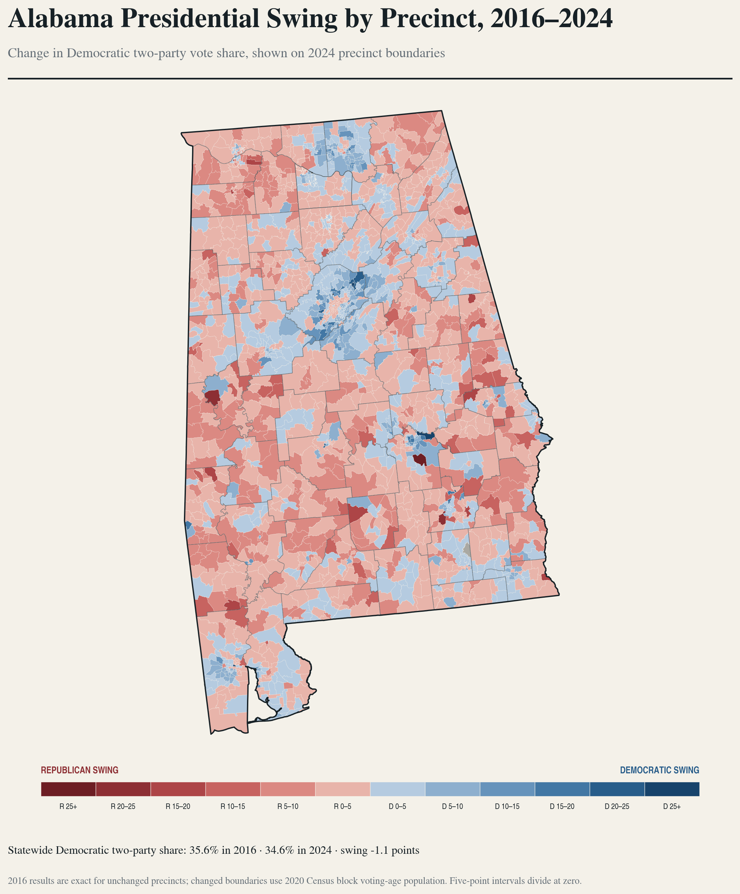
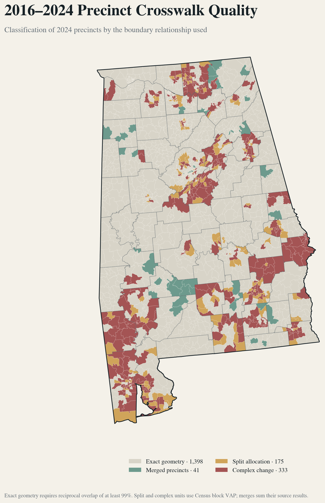
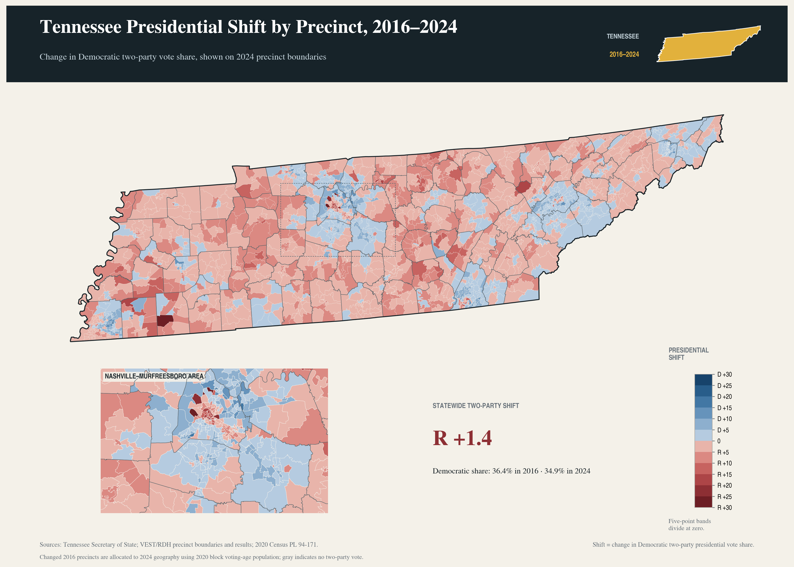
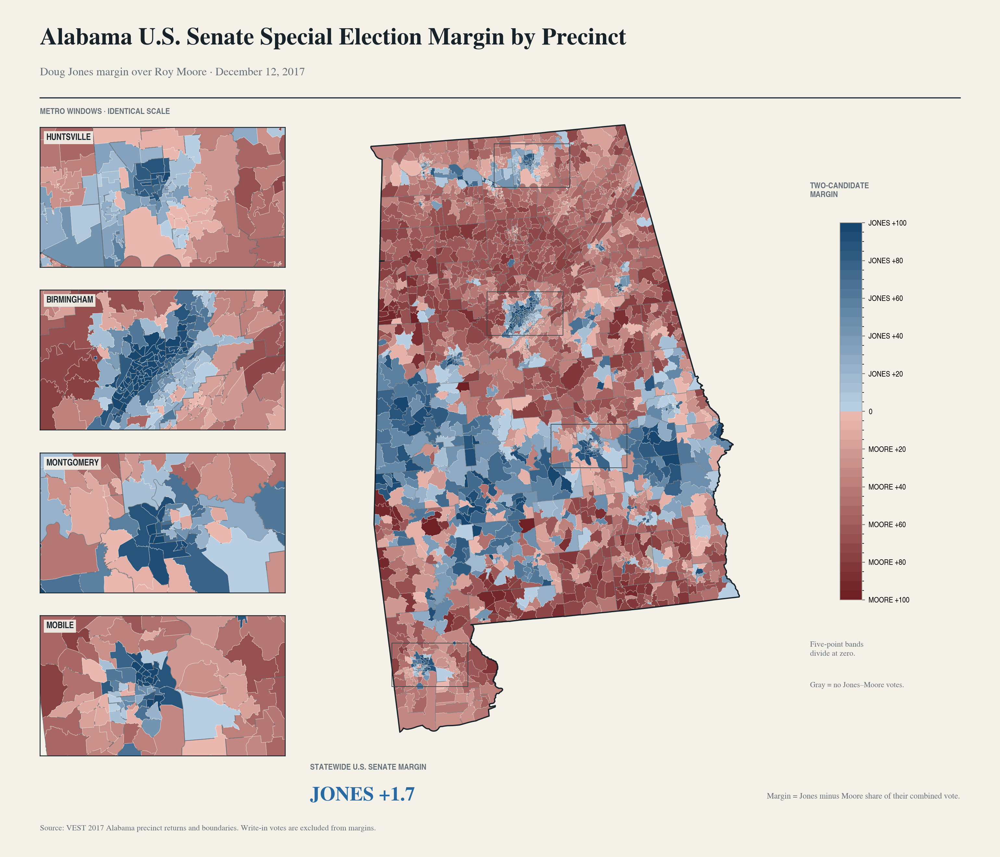
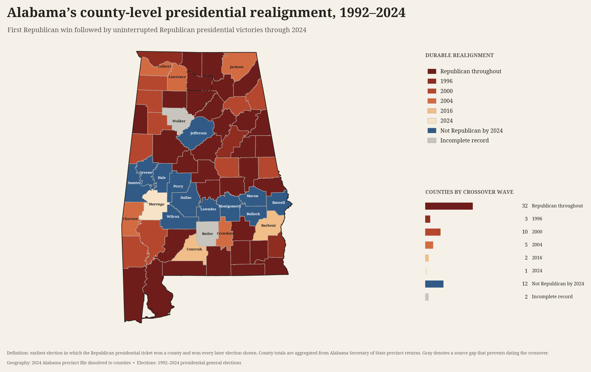
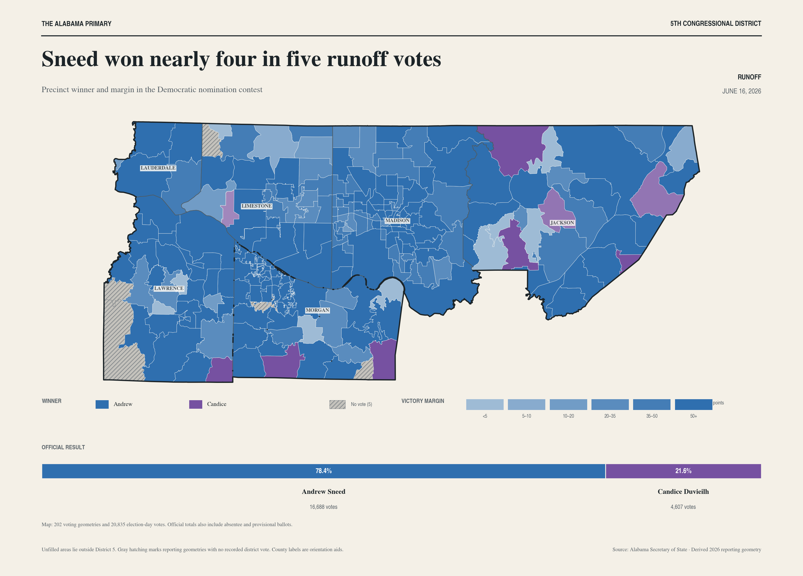

# Election Map Portfolio

Election cartography by Jackson A. Hannan. [Visit the portfolio website](https://jacksonahannan.github.io/election-map-portfolio/) to browse the full collection of precinct results, electoral change, turnout studies, hypothetical scenarios, design variants, and companion charts.

The searchable website now contains 1,115 unique works across 77 collections. It preserves the original six-map portfolio below, including the original PNGs, source attribution, saved audits and Python reproduction workflows. The additional collection is published as web-sized derivatives, with original paths and SHA-256 fingerprints retained. No raw election tables, source scans, or voter files are included.

## Website

The buildless site runs directly on GitHub Pages from `main` at the repository root. Search by race, district, state or year; combine geography, collection, year and subject filters; open any image for a larger view and collection source notes. A filtered view and individual map can be shared by URL. Scenarios are labeled as hypothetical.

For local preview, run `python -m http.server 8000` from this directory. To refresh from a local Election-Maps archive:

```bash
uv run python scripts/import-gallery.py --archive /path/to/Election-Maps
uv run python scripts/refresh-manifest.py
uv run python scripts/verify-portfolio.py
uv run pytest -q
```

`data/import-report.json` accounts for eligible renders, identical duplicates, excluded source/support images, and SVG alternatives. `data/gallery.json` retains source identity and collection notes; `data/gallery.js` is the same data for the browser. Web derivatives use a maximum 3,000-pixel edge plus 760-pixel thumbnails. The archive remains unchanged. Regenerate rather than hand-edit these files. Python workflows use GeoPandas, pandas, NumPy and Matplotlib.

[Browse the image gallery](index.html) · [Reproduction guide](docs/REPRODUCING.md) · [Sources and limitations](docs/DATA_SOURCES.md)

## Precinct swing with boundary-change diagnostics



This map was created using data from the Redistricting Data Hub. [RDH terms and conditions](https://redistrictingdatahub.org/terms-and-conditions/).

Historical precinct boundaries change. The Alabama workflow preserves exact matches and allocates changed 2016 precincts to 2024 geography using 2020 Census block voting-age population. Its saved audit reconciles candidate totals within every county: 2,000 historical precincts to 1,947 current precincts, with zero maximum county vote error. These are archived run results, not a fresh reconstruction for this snapshot.



This map was created using data from the Redistricting Data Hub. [RDH terms and conditions](https://redistrictingdatahub.org/terms-and-conditions/).

The companion diagnostic distinguishes exact geometry, merges, splits and complex changes. It makes the reconstruction visible alongside the headline map. [Source](scripts/create-alabama-2016-2024-presidential-swing-map.py) · [Saved audit](outputs/alabama-2016-2024-presidential-swing/crosswalk-audit.json)

## A second state, with metro context



This map was created using data from the Redistricting Data Hub. [RDH terms and conditions](https://redistrictingdatahub.org/terms-and-conditions/).

The Tennessee map combines a statewide view, Nashville–Murfreesboro inset and a fixed diverging scale. The crosswalk retains documented population and area fallback methods; it compares aggregate two-party vote shares, not individual voter transitions. [Source](scripts/create-tennessee-2016-2024-presidential-swing-map.py) · [Saved audit](outputs/tennessee-2016-2024-presidential-swing/crosswalk-audit.json)

## Historical results at statewide and metropolitan scales



This map was created using data from the Redistricting Data Hub. [RDH terms and conditions](https://redistrictingdatahub.org/terms-and-conditions/).

The Jones–Moore map uses four metro windows at an identical scale, repaired projected geometry and five-point margin classes. The denominator includes only the two named candidates; write-ins are excluded. [Source](scripts/create-alabama-2017-senate-special-election-map.py) · [Map specification](outputs/alabama-2017-senate-special-election/map_spec.json)

## Thirty-two years of county realignment



This map was created using data from the Redistricting Data Hub. [RDH terms and conditions](https://redistrictingdatahub.org/terms-and-conditions/).

Year-specific spreadsheet extractors reconcile county names and classify the first Republican presidential victory followed by uninterrupted wins through 2024. The finished map pairs categorical geography with a county-count chart; gray counties retain incomplete-record warnings. [Source](scripts/create-alabama-1992-2024-realignment-map.py)

## An original editorial election graphic



This map was created using data from the Redistricting Data Hub. [RDH terms and conditions](https://redistrictingdatahub.org/terms-and-conditions/).

A full-width map, candidate-specific margin shading and proportional official-result bar tell the runoff story. Reviewed precinct identities are joined exactly to derived 2026 reporting geography. Mapped election-day votes and official totals including absentee/provisional votes remain distinct; five no-vote geometries are hatched. [Source](scripts/create-alabama-cd5-2026-original-maps.py) · [Saved rendering audit](outputs/alabama-cd5-2026-democratic-primary/original-broadsheet/render-audit.json)

## What is included

The repository includes six PNG renders, five original Python rendering/analysis scripts, reusable integrity and cartography helpers, selected map specifications and saved audit summaries, tests and hash manifests. The source snapshot preserves original relative paths and excludes original Git history.

```bash
uv sync --group dev
uv run pytest -q
uv run python scripts/verify-portfolio.py
```

The gallery opens directly as a local HTML file. Rebuilding maps requires external election and geometry inputs documented in the [reproduction guide](docs/REPRODUCING.md). No raw election tables, precinct geometry, voter records, candidate photographs or downloaded source archives are shipped. Original map generation timestamps are unknown; the preparation snapshot is dated October 3, 2026.

Sources include the Alabama and Tennessee Secretaries of State, VEST, Redistricting Data Hub, the U.S. Census Bureau and county/Comptroller geometry providers. Provider processing may allocate absentee/provisional votes to precincts; changed boundaries require estimates. Preserve [source attribution and interpretation limits](docs/DATA_SOURCES.md) when reusing these images. The [MIT license](LICENSE) applies to code only; maps and external data retain applicable input terms.

## Related projects

[Political Map Studio](https://github.com/JacksonAHannan/political-map-studio) is the companion interactive layout editor with synthetic demonstration data. [Huntsville District 3 results](https://jacksonahannan.github.io/huntsville-district-3-results/) shows a separately published read-only election-results website.

## Resume description

Built Python election-cartography pipelines with GeoPandas, pandas and Matplotlib; reconciled changing precinct boundaries using reciprocal spatial overlap and Census block voting-age population, documented county-level vote-conservation checks, and published source-attributed case studies across Alabama and Tennessee.
